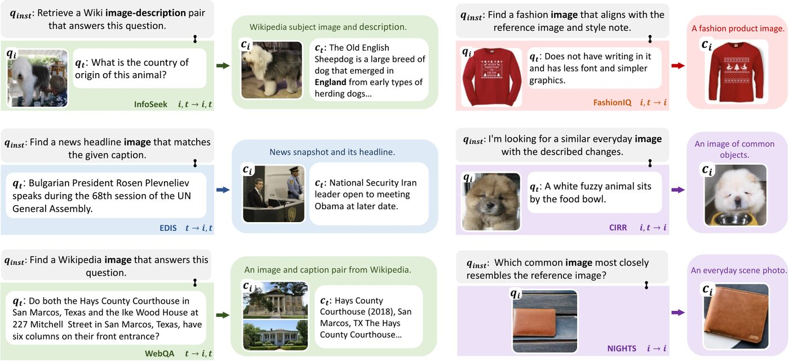
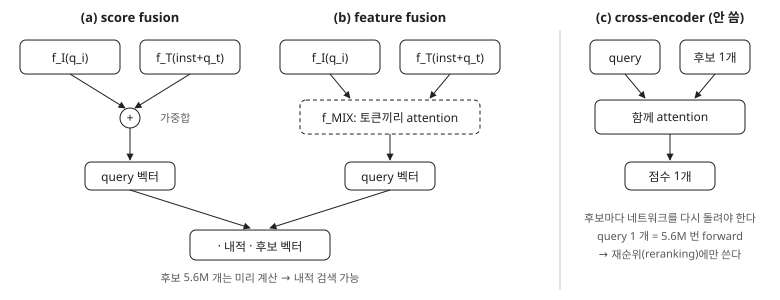
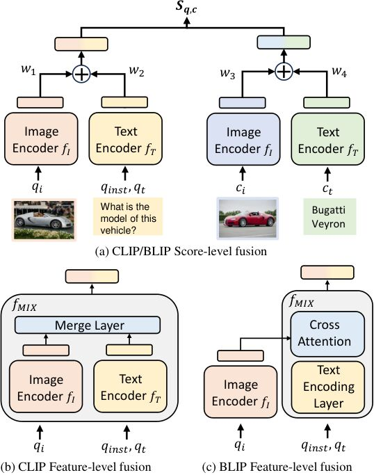

**Paper:** ECCV 2024, *UniIR: Training and Benchmarking Universal Multimodal Information Retrievers* (Wei, Chen, Chen, Hu, Zhang, Fu, Ritter, Chen)  
**arXiv:** [2311.17136](https://arxiv.org/abs/2311.17136)

<!--more-->

## 한눈에 (TL;DR)

- **무엇을** — 텍스트 · 이미지 · (이미지+텍스트) 어떤 형태의 query 로든, 어떤 형태의 후보든 찾아오는 **검색기 하나**를 만든다.
- **어떻게** — 기존 10 개 데이터셋을 한 형식으로 묶은 데이터 **M-BEIR** 를 만들고, query 앞에 «무엇을 찾을지» 적은 한 문장(**instruction**)을 붙여 CLIP/BLIP 을 contrastive 학습으로 fine-tune 한다.
- **결과** — 모든 형태의 후보 5.6M 개가 섞인 풀에서, instruction 없이 같은 조건으로 학습한 모델보다 Recall@5 평균 **36.1 → 48.9**. 엉뚱한 형태를 가져오는 오류는 **58.8% → 2.7%**. 학습에서 뺀 데이터셋에도 일반화한다.

용어 하나를 먼저 정리해 둔다. **M-BEIR 는 네트워크가 아니라 데이터(벤치마크)**이고, **UniIR 은 학습 방법의 이름**이다. 실제 네트워크는 UniIR 방식으로 학습한 CLIP 기반 모델 2 개와 BLIP 기반 모델 2 개, 모두 4 개이며 각각 따로 학습됐다.

## 1. Introduction — 왜 이 연구가 필요한가

검색엔진을 쓰는 사람의 요구는 제각각이다.

- «해변에서 노는 강아지» 라는 **글로 사진**을 찾고 싶다.
- 이 **사진**과 **똑같은 사진**을 찾고 싶다.
- 이 **사진 속 자동차가 무슨 모델인지**(사진 + 질문) **위키 문서**(사진 + 설명)에서 찾고 싶다.
- 이 **셔츠 사진**에 «**빨간색으로**» 를 더한 상품을 찾고 싶다.

지금까지의 검색 모델은 대부분 이 중 **한 가지 형식만** 다룬다. 글→사진 모델, 사진→사진 모델, 질문 답변용 모델을 과제마다 따로 만들고, 찾는 범위(후보 풀)도 과제마다 따로 둔다. CLIP 같은 모델을 그대로 «만능 검색기» 로 쓰려 해도, 사진 한 장이 들어왔을 때 사용자가 **비슷한 사진**을 원하는지 **그 사진의 설명**을 원하는지 모델이 알 길이 없다.

이 논문은 텍스트 검색에서 쓰이던 해법을 멀티모달로 가져온다. 텍스트 검색기 TART 는 query 와 함께 «무엇을 찾을지» 적은 문장, 곧 **instruction** 을 넣어 한 모델이 여러 과제를 하게 했다. UniIR 은 같은 생각을 이미지까지 넓히고, 그렇게 학습·평가할 데이터가 없으니 **M-BEIR** 를 함께 만든다.

> *“UniIR needs to follow the instructions to take a heterogeneous query to retrieve from a heterogeneous candidate pool with millions of candidates in diverse modalities.”* — [§1](https://arxiv.org/html/2311.17136#S1.p2)

## 2. Problem Definition — 문제를 쉽게 정의하면

**query** 는 텍스트 $$q_t$$, 이미지 $$q_i$$, 또는 둘의 쌍일 수 있다. 여기에 항상 **instruction** $$q_{inst}$$ 가 함께 온다.
**후보**도 텍스트 $$c_t$$, 이미지 $$c_i$$, 또는 둘의 쌍이고, 이 세 형태가 **한 풀 $$\mathcal{C}$$ 에 섞여** 있다. 후보에는 instruction 이 없다.
**목표**는 query 와 instruction 을 벡터 하나로, 후보도 벡터 하나로 만든 뒤 **내적이 가장 큰 후보**를 찾는 것이다.

$$
c^* = \arg\max_{c \in \mathcal{C}} \; f(q, q_{inst})^\top f(c)
$$

### 8 가지 검색 과제

| # | query → 후보 | 예시 데이터셋 | 쉽게 |
|---|---|---|---|
| 1 | q_t → c_i | VisualNews, MSCOCO, Fashion200K | 글로 사진 찾기 |
| 2 | q_t → c_t | WebQA | 질문으로 위키 문단 찾기 |
| 3 | q_t → (c_i, c_t) | EDIS, WebQA | 글로 사진+설명 찾기 |
| 4 | q_i → c_t | VisualNews, MSCOCO, Fashion200K | 사진으로 캡션 찾기 |
| 5 | q_i → c_i | NIGHTS | 비슷한 사진 찾기 |
| 6 | (q_i, q_t) → c_t | OVEN, InfoSeek | 사진에 대한 질문으로 문서 찾기 |
| 7 | (q_i, q_t) → c_i | FashionIQ, CIRR | 사진 + 수정 문구로 사진 찾기 |
| 8 | (q_i, q_t) → (c_i, c_t) | OVEN, InfoSeek | 사진+질문으로 사진+문서 찾기 |

과제 4 와 5 를 나란히 보면 문제의 핵심이 보인다. **같은 사진**을 넣어도 과제 4 면 캡션(텍스트)을, 과제 5 면 비슷한 사진을 가져와야 한다. 후보가 한 풀에 섞여 있으니 query 만으로는 둘을 구분할 수 없고, 그 구분을 instruction 이 맡는다.

## 3. Method — 데이터 · instruction · 모델 · 학습 · 검색

### 3.1 M-BEIR — 학습과 평가를 위한 통합 데이터

M-BEIR 는 데이터를 새로 모은 것이 아니라 **기존 10 개 데이터셋을 한 형식으로 다시 묶은 것**이다. 각 데이터셋의 원래 분할(train/val/test)과 성격은 그대로 두고, 너무 큰 데이터셋(VisualNews, OVEN, InfoSeek)만 줄여 균형을 맞췄다. 예시 하나는 이렇게 생겼다.

```text
{ query:       (이미지 and/or 텍스트),
  instruction: "Find a Wikipedia image-text pair that answers the question",
  positive:    [원래 데이터셋의 정답 후보]                ← 최소 1 개
  negative:    [원래 데이터셋이 주석해 둔 hard negative]   ← 없을 수도 있다 }
```

- 8 개 과제, 4 개 도메인(일상, 뉴스, 위키, 패션), 후보 **5.6M 개**.
- positive 와 negative 는 원래 데이터셋의 정답과 주석을 그대로 가져왔다. negative 를 새로 캐내는 것은 이 논문의 기여가 아니다.
- 평가 풀은 두 가지다. **M-BEIR(전역 풀)**은 5.6M 개 후보가 다 섞인 하나의 풀이고, **M-BEIR<sub>local</sub>** 은 데이터셋마다 자기 풀 안에서만 찾는다. 이 논문의 진짜 시험대는 전역 풀이다. 형태가 섞여 있어야 «텍스트를 원했는데 이미지를 가져오는» 실수가 드러나기 때문이다.



*논문 Figure 3. M-BEIR 예시 — 과제마다 query 앞에 instruction 이 붙고, 정답 후보가 함께 있다. 출처: Wei et al., arXiv:2311.17136, CC BY 4.0.*

### 3.2 Instruction — «무엇을 찾을지» 적은 한 문장

instruction 의 형식은 TART 의 **스키마**를 빌렸다. 스키마란 instruction 문장을 쓸 때 채우는 정해진 항목이다. TART 는 intent(무엇을) · domain(어디서) · unit(문단 · 문장 · 문서 중 어떤 단위로) 를 썼고, UniIR 은 텍스트 전용 항목인 unit 을 **query modality + 후보 modality** 로 바꿨다. 과제마다 사람이 이런 문장을 4 개씩 썼다.

> Fashion200K (글 → 사진): *“Based on the following fashion description, retrieve the best matching image.”* — 도메인(fashion), query 형태(description), 후보 형태(image), 의도(matching)가 한 문장에 다 들어 있다.

instruction 은 별도 모듈로 처리하지 않는다. **query 텍스트 앞에 이어 붙인 평범한 텍스트 토큰**일 뿐이라서, 텍스트 인코더는 «instruction + query 텍스트» 를 한 문장으로 읽는다. 같은 이유로 instruction 이 없는 후보 텍스트도 텍스트 인코더가 그대로 처리한다. CLIP 이 캡션을 인코딩하던 것과 같다. 즉 instruction 은 **구조상 필수는 아니지만, 성능상 필수**다. 실제로 instruction 없이 학습한 비교 모델은 엉뚱한 형태를 가져오는 오류가 크게 늘었다(4 장).

query 에 이미지만 있으면 텍스트 자리에는 instruction 만 들어간다. 그래서 query 의 텍스트 쪽은 비는 일이 없다.

### 3.3 모델 — 왜 query 와 후보를 따로 인코딩하는가

검색기는 후보 수백만 개를 상대해야 한다. 그래서 query 와 후보를 **따로 인코딩**해 각각 벡터 하나로 만들고, **내적 한 번**으로 비교하는 구조(dual encoder)를 쓴다. 후보 벡터는 미리 계산해 둘 수 있으니 검색이 빠르다. 만약 query 와 후보를 함께 넣어 attention 으로 비교하면(cross-encoder) 더 정확할 수는 있지만, query 하나마다 후보 5.6M 개에 대해 네트워크를 다시 돌려야 한다. 그런 구조는 검색이 아니라 소수 후보의 재순위(reranking)에 쓴다.

이것은 CLIP 의 원래 방식이기도 하다. CLIP 도 이미지와 텍스트를 따로 인코딩해 내적으로 비교할 뿐, 둘 사이에 attention 을 걸지 않는다.



*직접 그린 구조 비교도. (a)(b) 는 모두 query 와 후보를 따로 인코딩해 내적하므로 수백만 후보에서 검색할 수 있다. 둘의 차이는 query 안에서 이미지와 텍스트를 더하나(a), attention 으로 섞나(b) 뿐이다. (c) 는 정확하지만 검색기로 쓰기엔 너무 느려서 이 논문은 쓰지 않는다.*

그렇다면 남는 문제는 하나다. query 나 후보가 **(이미지, 텍스트) 쌍**일 때 둘을 어떻게 벡터 하나로 합치느냐다. 여기서 말하는 fusion 은 query 와 후보를 섞는 것이 아니라, **한쪽 안의 이미지와 텍스트를 합치는 것**이다. 논문은 두 가지 방법을 시험했다.



*논문 Figure 2. (a) score fusion — 이미지 벡터와 텍스트 벡터를 가중합. (b) CLIP<sub>FF</sub> — 두 인코더 위에 새 2 층 transformer. (c) BLIP<sub>FF</sub> — BLIP 의 cross-attention 으로 이미지를 텍스트에 섞는다. 출처: Wei et al., arXiv:2311.17136, CC BY 4.0.*

#### Score fusion (SF)

이미지 인코더 벡터와 텍스트 인코더 벡터를 그냥 더한다.

$$
\begin{aligned}
\mathbf{q} &= w_1 f_I(q_i) + w_2 f_T(q_{inst} \oplus q_t) \\
\mathbf{c} &= w_3 f_I(c_i) + w_4 f_T(c_t)
\end{aligned}
$$

단순해 보이지만, 두 벡터를 내적하면 항이 네 개로 풀린다.

$$
\begin{aligned}
s(q, c) = \; & w_1 w_3 \, f_I(q_i)^\top f_I(c_i) && \text{(이미지 ↔ 이미지)} \\
+ \; & w_2 w_4 \, f_T(q_{inst} \oplus q_t)^\top f_T(c_t) && \text{(텍스트 ↔ 텍스트)} \\
+ \; & w_1 w_4 \, f_I(q_i)^\top f_T(c_t) && \text{(query 이미지 ↔ 후보 텍스트)} \\
+ \; & w_2 w_3 \, f_T(q_{inst} \oplus q_t)^\top f_I(c_i) && \text{(query 텍스트 ↔ 후보 이미지)}
\end{aligned}
$$

즉 더한 벡터끼리 내적 한 번이 **같은 형태끼리의 유사도와 서로 다른 형태 사이의 유사도 네 개를 한꺼번에 합산**한 것과 같다. CLIP 은 이미 이미지와 텍스트를 같은 공간에 정렬해 두었으니 네 항 모두 의미가 있다. 그러면서도 결과는 여전히 벡터 하나라 미리 색인해 둘 수 있다. 새 파라미터가 없어 CLIP 이 사전학습에서 만든 공간을 그대로 쓰는 것도 장점이다. 가중치 $$w_1 \sim w_4$$ 는 «학습 가능» 하다고 소개되지만 실험에서는 **모두 1 로 고정**했다. 대가도 있다. query 안의 이미지와 텍스트가 서로를 «보지» 못하므로, «이 셔츠를 빨간색으로» 처럼 둘의 관계가 중요한 query 를 표현하는 데 약하다.

#### Feature fusion (FF)

이 약점을 노린 방법이다. query 안의 이미지 토큰과 텍스트 토큰이 **attention 으로 서로를 보며** 섞인 뒤 벡터 하나가 된다. BLIP 은 원래 이미지를 텍스트에 섞는 cross-attention(image-grounded text encoder)을 갖고 있어 그대로 쓰면 되고, CLIP 은 그런 층이 없어 두 인코더 위에 새 2 층 transformer(T5 구조)를 붙였다. 어느 쪽이든 query 와 후보는 여전히 따로 인코딩되고, 마지막 비교는 내적이다.

이렇게 해서 실험한 네트워크는 **CLIP<sub>SF</sub>, CLIP<sub>FF</sub>, BLIP<sub>SF</sub>, BLIP<sub>FF</sub>** 네 개다. CLIP 과 BLIP 이 한 네트워크에 함께 들어가는 것이 아니라, 각각 독립된 모델이다. backbone 은 모두 가장 큰 체크포인트인 ViT-L/14(이미지를 14×14 픽셀 패치로 자른다)이고, 해상도는 224 다(BLIP<sub>FF</sub> 는 384 버전도 있다).

### 3.4 학습 — query 와 정답 후보를 가깝게

M-BEIR 의 모든 과제를 섞어 **한 번에(multi-task)** 학습한다. score fusion 의 «더하기» 자체에는 학습할 것이 없으므로, 학습되는 것은 그 아래의 **이미지 · 텍스트 인코더**(FF 라면 fusion 층까지)다. 인코더가 «instruction 이 붙은 query 의 벡터» 가 맞는 후보 쪽을 향하도록 바뀐다.

목적함수는 **in-batch query-candidate contrastive loss** 다. 한 배치 안에서 query 와 그 정답 후보의 유사도는 높이고, 배치 안의 다른 후보들과의 유사도는 낮춘다.

$$
\mathcal{L} = -\log \frac{\exp\big(s(q, c^+)/\tau\big)}{\sum_{c \in \mathcal{B}} \exp\big(s(q, c)/\tau\big)}
$$

(논문 본문에는 식이 없고 «in-batch contrastive» 라고만 쓴다. 위는 그것을 표준 InfoNCE 꼴로 적은 것이다.)

이는 CLIP 사전학습의 ITC(image-text contrastive) 와 **같은 계열**이지만 두 가지가 다르다. 첫째, ITC 는 «이미지 ↔ 그 캡션» 을 맞추고 UniIR 은 «(query + instruction) ↔ 정답 후보» 를 맞춘다. 양쪽 모두 이미지 · 텍스트 · 쌍 어느 것이든 될 수 있다. 둘째, BLIP 사전학습에 쓰인 ITM(매칭 분류) · LM(캡션 생성) loss 는 쓰지 않고 contrastive loss 하나만 쓴다. 학습은 20 epoch, 배치 크기 105(CLIP) / 115(BLIP), H100 8 장 한 노드에서 했다.

### 3.5 검색 — 후보 bank 를 미리 만들어 두고 찾는다

학습이 끝나면 네 모델 중 **하나를 골라** 다음처럼 쓴다. 후보와 query 는 반드시 같은 모델로 인코딩해야 한다. 다른 모델이면 벡터 공간이 달라 비교가 안 된다.

1. **후보 bank 만들기** — 후보 풀 전체를 한 번 인코딩해 벡터 bank(색인)로 저장한다. 텍스트만 있는 후보는 이미지 자리에, 이미지만 있는 후보는 텍스트 자리에 padding 토큰을 넣는다. 후보에는 instruction 이 없으므로, 과제가 바뀌어도 bank 를 다시 만들 필요가 없다.
2. **query 인코딩** — query(이미지 and/or 텍스트) 앞에 instruction 을 붙여 같은 모델로 벡터 하나를 만든다. query 에 이미지가 없으면 이미지 자리가 padding 이다.
3. **찾기** — query 벡터와 bank 의 내적을 재서 큰 순서로 top-k 를 돌려준다.

그러니 쓸 때 이미지 · 텍스트 · instruction 이 셋 다 있어야 하는 것은 아니다. **query 는 이미지와 텍스트 중 하나 이상, 그리고 instruction 하나**면 된다.

## 4. Result

### 4.1 섞인 풀에서 — instruction 한 문장의 차이

비교 대상은 셋이다. **사전학습 모델**(CLIP · BLIP · BLIP2 를 fine-tune 없이 그대로), **multi-task 모델**(UniIR 과 같은 데이터 · 같은 모델 · 같은 학습이지만 instruction 없이), 그리고 **UniIR**. 사전학습 모델에는 instruction 을 넣지 않았는데, 넣어 봤더니 오히려 성능이 떨어졌다고 한다. instruction 을 읽도록 학습받은 적이 없으니 자연스러운 결과다.

| 모델 (M-BEIR 전역 풀, 후보 5.6M) | Recall@5 평균 |
|---|---:|
| 사전학습 BLIP2 (fine-tune 없음) | 5.9 |
| Multi-task CLIP<sub>SF</sub> (instruction 없이 학습) | 36.1 |
| **UniIR CLIP<sub>SF</sub>** (instruction 있음) | **48.9** (+12.8) |
| Multi-task BLIP<sub>FF</sub> | 34.6 |
| **UniIR BLIP<sub>FF</sub>** | **45.5** (+10.9) |

예를 들어 MSCOCO 글→사진은 27.3 → **77.9** 다. multi-task 와 UniIR 의 차이는 instruction 하나뿐이므로, 이 차이가 곧 instruction 의 효과다.

### 4.2 무엇이 좋아졌나 — 오류 분석

| 오류 종류 | Multi-task CLIP<sub>SF</sub> | UniIR CLIP<sub>SF</sub> |
|---|---:|---:|
| 엉뚱한 형태(modality)를 가져옴 | 58.8% | **2.7%** |
| 엉뚱한 도메인 | 0.3% | 0.1% |
| 그 밖의 오류 | 40.9% | 97.2% |

instruction 이 없을 때 틀린 것의 절반 이상은 «형태부터 틀린» 오류였고, instruction 을 넣자 거의 사라졌다. instruction 이 하는 일을 한마디로 하면, **query 벡터를 원하는 형태의 후보가 모인 쪽으로 옮기는 신호**다. 같은 강아지 사진이라도 «캡션을 찾아라» 가 붙으면 텍스트 후보 쪽으로, «같은 사진을 찾아라» 가 붙으면 이미지 후보 쪽으로 간다.

instruction 이 없으면 왜 형태를 틀리는지는 이렇게 이해할 수 있다. CLIP 공간에서는 이미지 벡터는 이미지끼리, 텍스트 벡터는 텍스트끼리 모이는 경향(modality gap)이 있어서, query 는 기본적으로 자기와 같은 형태의 후보 쪽으로 끌려간다. 그래서 사진→사진처럼 형태가 같은 과제는 instruction 없이도 어느 정도 맞지만, 사진으로 캡션을 찾는 것처럼 형태가 바뀌는 과제에서는 틀린다. instruction 이 그 끌림을 바로잡는다. *(modality gap 으로 설명한 부분은 결과에 대한 해석이며, 논문이 직접 이렇게 설명하지는 않는다.)*

### 4.3 처음 보는 데이터셋에서 — 일반화

WebQA · OVEN · CIRR 를 **학습에서 빼고** 학습한 뒤, 그 세 데이터셋으로 평가했다. 이 논문에서 «zero-shot» 은 이런 뜻이다. instruction 없이 쓴다는 뜻이 아니라 **그 데이터셋을 학습에서 본 적이 없다**는 뜻이고, UniIR 은 여기서도 instruction 을 넣어 평가한다.

결과는 UniIR 이 사전학습 모델과 multi-task 모델을 모두 앞섰다. 반면 instruction 없는 multi-task 모델은 사전학습 모델보다 조금 나은 정도였고, WebQA · OVEN 같은 과제에서는 오히려 더 나빴다. 일반화를 만든 것은 여러 과제를 함께 학습한 것보다 **instruction** 쪽이라는 뜻이다.

처음 보는 데이터셋인데도 instruction 이 통하는 이유는 두 가지로 볼 수 있다.

- 모든 instruction 이 같은 틀(intent · domain · modality)로 쓰여 있어서, 새 데이터셋의 문장도 «이미지를, 위키에서 찾아라» 처럼 학습 때 본 패턴으로 읽힌다.
- 데이터셋은 처음이어도 과제 형태는 익숙하다. 예를 들어 CIRR 를 빼도 같은 과제 7 인 FashionIQ 는 학습에 있었다.

### 4.4 구조 비교 — 사전학습 구조를 따르라

| 모델 | SF | FF |
|---|---:|---:|
| CLIP | **48.9** | 43.3 |
| BLIP | 42.7 | **45.5** |

CLIP 은 원래 dual encoder 라 SF 가, BLIP 은 원래 cross-attention 이 있어 FF 가 이겼다. 이 결과는 «어느 fusion 이 낫다» 가 아니라 **«사전학습 때의 구조를 따르는 쪽이 낫다»** 로 읽어야 한다. CLIP<sub>FF</sub> 는 무작위로 초기화한 새 층이 과적합했다고 논문은 본다. 특히 이미지+질문으로 이미지+문서를 찾는 과제 8 에서 52.4 → 46.3 으로 크게 떨어졌다. 반대로 사진으로 사진을 찾는 과제 5 에서는 두 방식의 차이가 거의 없는데(+0.1, −0.4), 합칠 텍스트가 instruction 밖에 없으니 당연하다.

### 4.5 multi-task 가 single-task 보다

데이터셋 하나씩 따로 학습한 모델보다, 다 섞어 학습한 UniIR(BLIP<sub>FF</sub>)이 평균 Recall@5 를 **+9.7** 높였다고 보고한다(Table 6). 과제끼리 서로 도움이 된다.

## 5. Conclusion

- **UniIR** — instruction 을 따라 어떤 형태의 query 로든 어떤 형태의 후보든 찾는 검색기 하나를 학습하는 방법을 제시했다.
- **M-BEIR** — 10 개 데이터셋 · 8 개 과제 · 후보 5.6M 개를 묶은 첫 통합 멀티모달 검색 벤치마크를 만들었다.
- **발견 세 가지** — ① instruction tuning 이 섞인 풀에서의 검색과 처음 보는 데이터셋으로의 일반화를 크게 높인다. ② 여러 과제를 함께 학습하면 각각 학습할 때보다 낫다. ③ fusion 구조는 사전학습 구조를 따르는 것이 낫다.

이후 VLM2Vec · MM-Embed · GME 같은 MLLM 기반 검색기들이 M-BEIR 로 평가하고 instruction 방식을 이어받으면서, 이 논문은 범용 멀티모달 검색의 출발점이 됐다.

## 6. 리뷰 의견

### 이 논문의 기여는 어디에 있나

모델 기법만 보면 새로운 것이 거의 없다. instruction 을 query 앞에 붙이고, 기존 CLIP/BLIP 을 기존 contrastive loss 로 fine-tune 한 것이 전부다. 그런데도 ECCV 에 실린 이유는 기여가 기법이 아닌 곳에 있기 때문이다.

1. **문제를 새로 세웠다.** «검색기 하나로, 모든 형태가 섞인 후보 풀에서, instruction 을 따라 찾는다» 는 설정을 멀티모달에서 처음 제대로 정의했다. 이전에는 과제마다 모델도 풀도 따로였다.
2. **벤치마크를 만들었다.** M-BEIR 는 이후 이 분야의 표준 평가가 됐다.
3. **무엇이 통하는지 깨끗하게 보였다.** 같은 모델 · 같은 데이터에서 instruction 만 넣고 빼는 대조로 효과를 분리했고(+12.8), 오류 분석으로 «왜» 좋아지는지(형태 오류 제거)까지 보였다. 일반화 실험과 구조 비교는 설계 지침이 된다.
4. **시점이 좋았다.** 텍스트 검색에서는 instruction 검색이 자리 잡았지만 멀티모달에는 없던 공백을 처음 메웠다.

### 강점

- 문제 설정이 현실적이다. 실제 검색엔진처럼 모든 형태의 후보가 한 풀에 있다.
- 방법이 단순해 재현과 확장이 쉽다. 후보 bank 를 과제와 상관없이 하나로 쓸 수 있는 것도 실용적이다.
- instruction 효과를 같은 조건 대조와 오류 분석으로 설득력 있게 보였다.

### 약점과 남는 질문

1. **기법의 novelty 가 약하다.** 모델 쪽 기여는 instruction prefix 와 기존 contrastive fine-tune 이다.
2. **«학습 가능한 가중치» 가 실제로는 1 로 고정**이다. 학습하거나 튜닝하면 어떻게 되는지 보고가 없다.
3. **instruction 의 이득 대부분이 형태 선택**이다. «그 밖의 오류» 를 더 쪼개 보지 않아, 의미 수준의 의도까지 이해하는지는 알 수 없다.
4. **instruction 효과의 분리가 완전하지 않다.** 사전학습 모델에는 instruction 을 넣지 않았고, 학습된 UniIR 에서 instruction 만 빼고 평가한 실험도 없다. multi-task 대조가 이를 어느 정도 보완한다.
5. **CLIP<sub>FF</sub> 의 패배는 «새 층 무작위 초기화» 탓일 수 있다.** 사전학습된 fusion 층으로 바꾼 실험은 없다.
6. **학습 규모 표기가 어긋난다.** 서론은 300K, Table 1 의 train 열 합은 약 1.1M 이다.

### 실제로 쓴다면

방식 자체는 바로 쓸 수 있다. 내 데이터로 후보 bank 를 만들고, 화면에서 «사진 찾기 / 문서 찾기» 를 고르면 시스템이 정해 둔 instruction 을 query 에 붙이면 된다. 다만 open world 에서는 한계가 분명하다.

- **instruction 표현이 학습 때와 비슷해야 한다.** 학습에 쓴 instruction 은 과제당 4 개, 모두 수십 개뿐이고 텍스트 인코더도 CLIP · BLIP 수준이다. 표현이 많이 다르면 잘 알아듣지 못할 수 있으니 M-BEIR 의 틀을 따라 쓰는 게 안전하다.
- **도메인이 네 개뿐이다.** 일상 · 뉴스 · 위키 · 패션 밖, 예컨대 산업 현장 데이터에서는 보장이 없다.
- **과제 형태가 8 가지에 묶여 있다.** 동영상이나 긴 문서는 다루지 않는다.

이 한계 — 약한 instruction 이해력과 좁은 modality — 를 MLLM 으로 풀려는 것이 다음 흐름(VLM2Vec · MM-Embed · GME · VLM2Vec-V2)이다.

## 정리

한 문장으로 요약하면 이렇다.

> **UniIR 은 query 앞에 «무엇을 찾을지» 적은 instruction 한 문장을 붙여 CLIP/BLIP 을 multi-task contrastive 로 fine-tune 함으로써, 모든 형태가 섞인 5.6M 후보 풀에서 검색기 하나로 8 가지 멀티모달 검색을 해내고, 그 평가 무대인 M-BEIR 를 함께 세운 논문이다.**

---

*원문 인용 · 그림 · 표 숫자는 Wei et al., “UniIR: Training and Benchmarking Universal Multimodal Information Retrievers”, arXiv:2311.17136 (CC BY 4.0) 에서 가져왔다(Table 2 · 4 · 5 · 6, Figure 2 · 3, 부록 6.2). TART 스키마 항목은 TART 논문(Asai et al., 2022) 기준이다. 해설과 리뷰 의견은 글쓴이의 것이다.*
