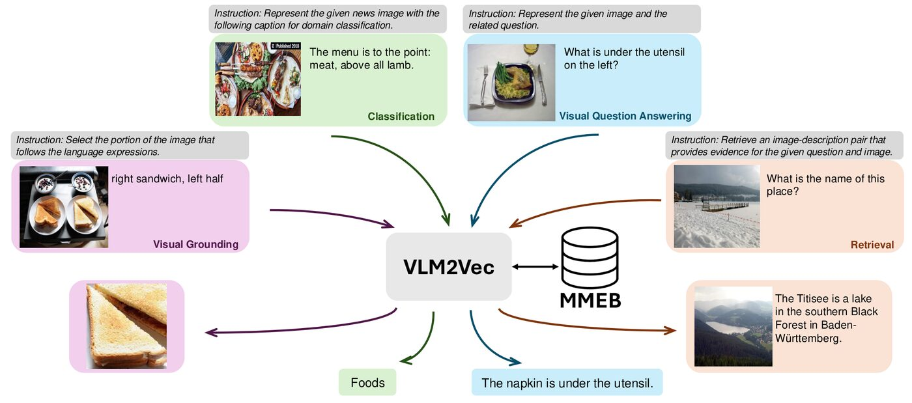
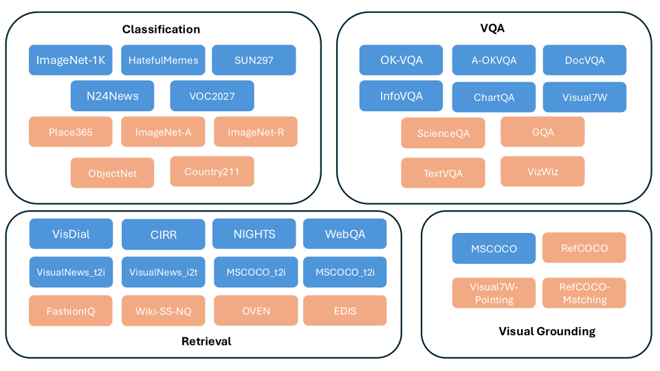
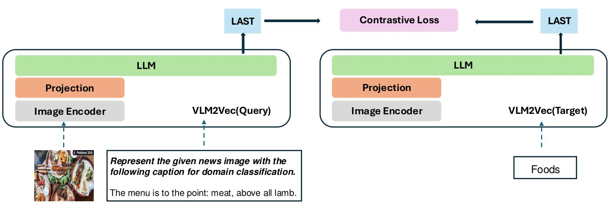
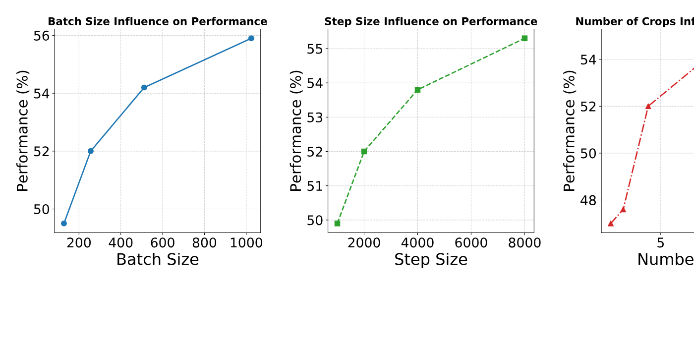

**Paper:** ICLR 2025, *VLM2Vec: Training Vision-Language Models for Massive Multimodal Embedding Tasks* (Jiang, Meng, Yang, Yavuz, Zhou, Chen)  
**arXiv:** [2410.05160](https://arxiv.org/abs/2410.05160)

<!--more-->

## 한눈에 (TL;DR)

- **무엇을** — 이미지 · 텍스트를 어떤 조합으로 넣든, instruction 을 따라 **고정 길이 벡터 하나**를 내는 범용 멀티모달 임베딩 모델을 만든다.
- **어떻게** — CLIP 이 아니라 **VLM(Phi-3.5-V, LLaVA-1.6)**을 backbone 으로 쓰고, 마지막 토큰의 마지막 층 벡터를 임베딩으로 삼아 contrastive 학습한다. 학습 · 평가를 위해 36 개 데이터셋 · 4 개 메타과제의 **MMEB** 를 만든다.
- **결과** — MMEB 36 개 평균 Precision@1 **62.9**. fine-tune 없는 최고 baseline(UniIR CLIP<sub>SF</sub>, 44.7)보다 +18.2, 학습에 안 쓴 16 개(OOD)에서도 **57.1**(+15.4).
- **핵심 한 줄** — 새 기법이 아니라 **«VLM 을 임베딩용으로 fine-tune 하는 레시피» + «MMEB 벤치마크» + «실험으로 보인 설계 지침»** 이 이 논문의 전부이자 기여다.

이름 정리: **MMEB 는 데이터(벤치마크)**, **VLM2Vec 은 학습 방법이자 그렇게 학습한 모델**의 이름이다. [UniIR 리뷰]()에서의 M-BEIR / UniIR 관계와 같다.

## 1. Introduction — 왜 이 연구가 필요한가

텍스트 쪽에서는 «범용 임베딩» 이 이미 자리를 잡았다. MTEB 라는 표준 벤치마크가 있고, 거기서 LLM 을 backbone 으로 instruction 을 넣어 학습한 임베딩 모델(E5-Mistral, NV-Embed 등)이 좋은 성적을 낸다. 멀티모달 쪽은 이만큼 오지 못했다. 저자들이 짚는 한계는 두 가지다.

1. **평가가 과제별로 흩어져 있다.** 이미지 임베딩은 ImageNet 분류, MSCOCO · Flickr 검색처럼 따로따로 재 왔다. 범용성을 한 번에 재는 기준이 없다.
2. **모델이 얕게 섞는다.** CLIP · BLIP · SigLIP 은 이미지와 텍스트를 따로 인코딩하거나, 섞더라도 마지막에 얕게 섞는다(UniIR 의 «더하기» 가 대표적이다). 그래서 이미지와 텍스트 사이의 관계를 깊이 잡지 못하고, instruction 을 이해하는 능력도 약하다.

이 논문의 답도 두 가지다. 범용성을 재는 **MMEB** 를 만들고, 이미지와 텍스트를 한 transformer 안에서 깊게 섞는 **VLM** 을 임베딩 모델로 바꾸는 **VLM2Vec** 을 제안한다. VLM 은 이미 대량의 이미지-텍스트로 학습돼 있고, 고해상도 이미지와 긴 텍스트를 받으며, instruction 을 따르도록 길러진 모델이라 범용 임베딩에 잘 맞는다는 것이 저자들의 논리다.



*논문 Figure 1. MMEB 의 과제들과, instruction 을 따라 어떤 이미지 · 텍스트 조합이든 벡터로 만드는 VLM2Vec. 출처: Jiang et al., arXiv:2410.05160.*

## 2. Problem Definition — MMEB: 모든 과제를 «순위 매기기» 로

MMEB 의 핵심 아이디어는 **성격이 전혀 다른 과제를 전부 같은 꼴로 바꾸는 것**이다. 모든 과제는 «instruction + query 가 주어지면, 후보 중 정답을 1 등으로 올려라» 는 순위 매기기 문제가 된다. 임베딩 모델은 query 를 벡터 하나로, 후보들을 각각 벡터로 만들고, **내적(코사인)이 가장 큰 후보**를 답으로 낸다.

| 메타과제 | query | 후보 | 예 |
|---|---|---|---|
| **분류** (10) | instruction + 이미지 (+ 텍스트) | 클래스 이름들 (텍스트) | ImageNet: 이미지 → «golden retriever» 를 1000 개 라벨 중에서 고르기 |
| **VQA** (10) | instruction + 이미지 + 질문 | 답 텍스트 1 개 + 오답 999 개 | DocVQA, ChartQA, OK-VQA |
| **검색** (12) | 텍스트 · 이미지 · 쌍 (+ instruction) | 텍스트 · 이미지 · 쌍 | MSCOCO t2i/i2t, CIRR, WebQA, NIGHTS |
| **Visual grounding** (4) | instruction(«빨간 사과를 찾아라») + 전체 이미지 | 이미지에서 잘라낸 영역 1000 개 | RefCOCO, Visual7W-Pointing |

분류는 «라벨 이름을 후보로 둔 검색», VQA 는 «답을 후보로 둔 검색», grounding 은 «잘라낸 영역을 후보로 둔 검색» 이 된다. 이렇게 바꾸면 임베딩 모델 하나로 네 메타과제를 다 잴 수 있다.

- **36 개 데이터셋** 중 **20 개는 학습용(IND)**, **16 개는 평가에만 쓰는 OOD** 다. 보고하는 점수는 36 개 전부(학습한 20 개 포함)의 평균과, IND · OOD 따로의 평균이다.
- 후보 수는 query 마다 **1,000 개**(분류는 클래스 수)로 정했다. 많으면 평가가 느리고, 적으면 너무 쉬워 점수가 금방 포화되기 때문이다.
- 지표는 **Precision@1** — 정답을 1 등으로 올린 비율이다.



*논문 Figure 2. MMEB 의 4 개 메타과제와 36 개 데이터셋. 파란색이 학습용 20 개, 주황색이 평가 전용 16 개. 출처: Jiang et al., arXiv:2410.05160.*

## 3. Method — VLM 을 임베딩 모델로 바꾸기

### 3.1 구조 — 여전히 «따로 인코딩 → 비교»

UniIR 과 마찬가지로 query 와 후보는 **따로 인코딩**되고 마지막에 유사도로 비교된다. 그래서 후보 벡터를 미리 만들어 두고 검색할 수 있다. 그림에서 Query 와 Target 이 두 상자로 그려져 있지만, **같은 VLM 하나**(가중치 공유)를 두 번 쓰는 것이다.

달라진 것은 한쪽 안에서 이미지와 텍스트를 합치는 방식이다. VLM 은 이미지를 이미지 인코더 → projection 을 거쳐 **LLM 의 토큰처럼** 바꾸고, 그 이미지 토큰들을 텍스트 토큰과 **한 줄로 이어 붙여** LLM 에 넣는다. LLM 의 모든 층에서 이미지 토큰과 텍스트 토큰이 attention 으로 서로를 본다. UniIR 의 score fusion(벡터를 더하기만)이나 feature fusion(위에 2 층만 얹기)과 비교하면 훨씬 **깊게(early · deep fusion)** 섞인다.



*논문 Figure 3. 이미지는 Image Encoder → Projection 을 거쳐 LLM 에 텍스트와 함께 들어가고, 마지막 토큰(LAST)의 벡터가 임베딩이 된다. query 와 target 은 같은 모델로 따로 인코딩되고 contrastive loss 로 학습된다. 출처: Jiang et al., arXiv:2410.05160.*

### 3.2 임베딩 = 마지막 토큰의 마지막 층 벡터

VLM 은 원래 다음 단어를 생성하는 모델이라 «벡터 하나» 를 내놓는 출력이 따로 없다. VLM2Vec 은 **입력의 마지막 토큰이 마지막 층에서 가진 벡터**를 임베딩으로 쓴다. 이유는 LLM 의 attention 구조에 있다. LLM 은 각 토큰이 자기보다 **앞의 토큰만** 볼 수 있는(causal) 구조라서, 입력 전체를 다 본 토큰은 맨 마지막 토큰 하나뿐이다. 그래서 마지막 토큰의 벡터가 입력 전체의 요약 역할을 한다. 텍스트 임베딩 쪽(E5-Mistral 등)에서도 쓰던 방식이다.

### 3.3 Instruction 넣는 법

query 는 다음 형식의 한 덩어리로 만들어 넣는다.

```text
q_inst = [IMAGE_TOKEN] Instruct: {task_definition} \n Query: {q}
```

`{task_definition}` 자리에 과제를 한 문장으로 설명한 instruction 이 들어간다. 예: *“Represent the given news image with the following caption for domain classification.”* 과제마다 따로 instruction 을 손으로 만들었다. UniIR 처럼 instruction 은 별도 모듈이 아니라 **입력 텍스트의 일부**이고, 차이는 그 텍스트를 읽는 쪽이 CLIP 텍스트 인코더가 아니라 **LLM** 이라는 점이다. 텍스트 길이도 CLIP 의 77 토큰 제한 대신 최대 256 토큰을 쓴다.

후보 쪽은 UniIR 과 조금 다르다. 논문은 «후보도 텍스트 · 이미지 · instruction 의 조합일 수 있다» 고 쓴다. 과제에 따라 후보 쪽에도 짧은 지시문이 붙을 수 있다는 뜻이며, 구체적인 형식은 부록 표(Table 7~10)에 있다. Figure 3 의 분류 예처럼 후보가 «Foods» 같은 라벨 한 단어인 경우도 있다.

### 3.4 학습 — InfoNCE + 큰 배치

query 와 정답 후보의 유사도는 높이고, 다른 후보와의 유사도는 낮추는 표준 **InfoNCE** 다. 유사도는 temperature 를 곱한 코사인이다.

$$
\mathcal{L} = -\log \frac{\phi(q, t^+)}{\phi(q, t^+) + \sum_{t^- \in \mathbb{N}} \phi(q, t^-)},
\qquad
\phi(q, t) = \exp\!\left(\frac{\cos(\mathbf{h}_q, \mathbf{h}_t)}{\tau}\right),\;\; \tau = 0.02
$$

UniIR 의 in-batch contrastive 와 같은 계열이다. negative 집합 $$\mathbb{N}$$ 은 «배치 안의 다른 후보 + hard negative» 라고 적혀 있지만, 바로 다음 절에서 «대부분의 멀티모달 데이터셋은 hard negative 를 모으기 어렵다» 고 말한다. 그래서 실제로 힘을 쓰는 것은 **배치 안의 무작위 negative** 이고, negative 를 늘리려면 **배치를 키워야** 한다.

### 3.5 GradCache — 메모리 안에서 배치 1,024 만들기

VLM 은 크고 이미지 하나가 토큰 수백~수천 개가 되므로, 배치 1,024 를 한 번에 GPU 에 올릴 수 없다. 그렇다고 그냥 작은 배치로 나눠 gradient 를 누적하면 안 된다. contrastive loss 는 **배치 전체의 벡터를 서로 비교**해야 계산되므로, 작게 나누면 negative 수도 작아진다. GradCache 는 이 문제를 두 단계로 푼다.

1. **벡터만 먼저** — gradient 없이 sub-batch 4 개씩 돌려 1,024 개 전부의 임베딩을 구하고, 그 벡터들로 전체 배치의 loss 를 계산한다. 그리고 각 임베딩에 대한 gradient $$u_i = \partial \mathcal{L} / \partial f(q_i)$$ 만 저장해 둔다.
2. **다시 돌며 누적** — sub-batch 를 하나씩 다시 순전파해서, 저장해 둔 $$u_i$$ 를 이어 붙여 파라미터 gradient 를 계산하고 누적한다.

결과는 배치 1,024 를 한 번에 돌린 것과 같은 gradient 다. 대가는 순전파를 두 번 하는 계산 시간이다.

### 3.6 학습 설정

- backbone: Phi-3.5-V 와 LLaVA-1.6. 전체 fine-tune(FFT) 과 LoRA(rank 8) 둘 다 시험.
- 배치 1,024, 2K step, temperature 0.02, 최대 텍스트 256 토큰, H100 8 장.
- 학습 데이터: 학습용 20 개 데이터셋에서 각 최대 50K 개를 뽑아 총 662K 개.
- 이미지: Phi-3.5-V 는 sub-image crop 4 개, LLaVA-1.6 은 336×336(저해상도)과 1344×1344(고해상도) 두 설정.

쓸 때는 UniIR 과 똑같다. 학습된 모델로 후보 bank 를 미리 만들어 두고, instruction 을 붙인 query 벡터와 코사인 유사도로 찾는다. 다만 후보 하나를 인코딩하는 데 CLIP 보다 훨씬 큰 모델이 돌아가므로, bank 를 만드는 비용과 query 마다 드는 시간이 크다.

## 4. Result

### 4.1 주 결과 — 모든 메타과제에서 고르게

| 모델 (Precision@1) | 분류 | VQA | 검색 | grounding | IND | OOD | 전체 |
|---|---:|---:|---:|---:|---:|---:|---:|
| CLIP | 42.8 | 9.1 | 53.0 | 51.8 | 37.1 | 38.7 | 37.8 |
| UniIR (CLIP<sub>SF</sub>) | 44.3 | 16.2 | 61.8 | 65.3 | 47.1 | 41.7 | 44.7 |
| E5-V | 21.8 | 4.9 | 11.5 | 19.0 | 14.9 | 11.5 | 13.3 |
| OpenCLIP-FFT (MMEB 로 fine-tune) | 56.0 | 21.9 | 55.4 | 64.1 | 50.5 | 43.1 | 47.2 |
| VLM2Vec Phi-3.5-V, FFT | 52.8 | 50.3 | 57.8 | 72.3 | 62.8 | 47.4 | 55.9 |
| VLM2Vec Phi-3.5-V, LoRA | 54.8 | 54.9 | 62.3 | 79.5 | 66.5 | 52.0 | 60.1 |
| VLM2Vec LLaVA-1.6, LoRA, 336 | 54.7 | 50.3 | 56.2 | 64.0 | 61.0 | 47.5 | 55.0 |
| **VLM2Vec LLaVA-1.6, LoRA, 1344** | 61.2 | 49.9 | 67.4 | 86.1 | 67.5 | **57.1** | **62.9** |

가장 눈에 띄는 것은 **VQA** 다. CLIP 계열은 4~22 점에 머무는데 VLM2Vec 은 50 안팎이다. 이미지와 질문을 함께 이해해야 하는 과제라서, 깊게 섞는 VLM 의 장점이 가장 크게 드러난다. 반대로 검색은 UniIR(61.8) 대비 차이가 작다(+5.6). UniIR 이 바로 검색용으로 학습된 모델이기 때문이다. 해상도도 중요하다. 같은 LLaVA-1.6 이 336 → 1344 로 올리자 전체 55.0 → 62.9 가 됐다.

저자들은 LLaVA-1.6 의 사전학습 데이터가 공개돼 있고 OOD 데이터셋과 거의 겹치지 않는다는 점을 들어, OOD 성적이 «backbone 이 이미 본 데이터» 덕이 아니라고 주장한다.

### 4.2 LoRA 가 전체 fine-tune 보다 낫다

| Phi-3.5-V, 배치 256 | 전체 |
|---|---:|
| 전체 fine-tune | 52.0 |
| LoRA r=4 | **58.4** |
| LoRA r=8 | 58.2 |
| LoRA r=16 | 50.8 |
| LoRA r=32 | 53.4 |

작은 rank 의 LoRA 가 전체 fine-tune 보다 6 점 넘게 높다. VLM 이 가진 능력을 크게 건드리지 않고 «벡터를 내는 법» 만 살짝 가르치는 쪽이 낫다는 해석이 가능하다. 다만 r=16 에서 갑자기 떨어지는 등 rank 에 따라 출렁인다.

### 4.3 배치 · step · crop 은 클수록 좋다

Phi-3.5-V 기준으로 배치를 128 → 256 → 512 → 1,024 로 늘리면 전체 점수가 약 49.5 → 52.0 → 54.2 → 55.9 로, 학습 step 을 1K → 8K 로 늘리면 약 49.9 → 55.3 으로 꾸준히 오른다(Figure 4 그래프에서 읽은 값). sub-image crop 수도 늘릴수록 좋아진다. hard negative 가 부족하니 **큰 배치의 무작위 negative** 가 핵심이라는 3.4 의 주장을 뒷받침한다. 세 곡선 모두 아직 포화되지 않았다.



*논문 Figure 4. 배치 크기 · 학습 step · sub-image crop 수에 따른 MMEB 점수 변화. 출처: Jiang et al., arXiv:2410.05160.*

### 4.4 검색 과제로 학습하면 다른 과제로도 잘 옮겨 간다

한 메타과제로만 학습한 모델 셋(VLM2Vec<sub>RET</sub> · VLM2Vec<sub>VQA</sub> · VLM2Vec<sub>CLS</sub>)을 만들어, 학습하지 않은 메타과제에서 재 봤다. **검색으로 학습한 모델이 가장 잘 일반화**했고, 특히 grounding 에서 차이가 컸다. 저자들은 검색 과제가 query · 후보 양쪽에 가장 다양한 이미지 · 텍스트 조합을 담고 있기 때문이라고 본다. → 학습 과제는 다양할수록 좋다.

### 4.5 instruction — CLIP 에는 독, VLM2Vec 에는 약

| 모델 | instruction 없음 | 있음 | 변화 |
|---|---:|---:|---:|
| CLIP | 37.8 | 26.7 | −29.4% |
| VLM2Vec (Phi-3.5-V, FFT, 배치 256) | 34.8 | 52.0 | +49.4% |

CLIP 에 instruction 을 붙이면 오히려 떨어진다(특히 분류 42.8 → 17.4). CLIP 텍스트 인코더는 캡션 같은 짧은 묘사에 맞춰져 있어, «다음 이미지를 분류하라» 같은 지시문이 오히려 벡터를 흐린다. UniIR 리뷰에서 사전학습 CLIP 에 instruction 을 넣지 않은 이유와 같다. 반면 VLM2Vec 은 instruction 으로 모든 메타과제가 오르고, 검색이 가장 크게(+69%) 오른다. LLM 이 instruction 을 «읽고 따르는» 능력을 이미 갖고 있기 때문이라는 것이 저자들의 해석이다.

## 5. Conclusion

- **MMEB** — 분류 · VQA · 검색 · grounding 4 개 메타과제, 36 개 데이터셋을 모두 «instruction + query → 후보 순위» 로 통일한 범용 멀티모달 임베딩 벤치마크.
- **VLM2Vec** — VLM 의 마지막 토큰 벡터를 임베딩으로 쓰고 instruction 을 붙여 contrastive 학습하면, 어떤 VLM 이든 범용 임베딩 모델이 된다.
- **발견** — ① VLM 은 «숨은 강한 임베딩 모델» 이다(특히 이미지+질문이 얽힌 과제). ② 큰 배치(GradCache)와 고해상도가 중요하다. ③ LoRA 가 전체 fine-tune 보다 낫다. ④ instruction 은 VLM backbone 에서만 제대로 효과를 낸다. ⑤ 학습 과제는 다양할수록 일반화가 좋다.

이 논문 이후 MMEB 는 멀티모달 임베딩의 표준 벤치마크가 됐고, «MLLM 을 임베딩 모델로» 라는 흐름(GME, VLM2Vec-V2, Qwen3-VL-Embedding …)의 출발점이 됐다.

## 6. UniIR 에서 무엇이 바뀌었나

| | UniIR (ECCV'24) | VLM2Vec (ICLR'25) |
|---|---|---|
| backbone | CLIP / BLIP (ViT-L) | VLM (Phi-3.5-V, LLaVA-1.6) — 수십억 파라미터 |
| 이미지+텍스트 합치기 | 벡터 더하기(SF) 또는 위에 얕은 층(FF) | 이미지 토큰을 텍스트 토큰과 이어 LLM 전 층에서 attention (deep fusion) |
| 임베딩 | 인코더 출력 벡터(의 합) | 마지막 토큰의 마지막 층 벡터 |
| instruction 을 읽는 쪽 | CLIP/BLIP 텍스트 인코더 (77 토큰) | LLM (256 토큰) |
| 학습 | in-batch contrastive, 배치 ~110, 20 epoch, 전체 fine-tune | InfoNCE, 배치 1,024 (GradCache), 2K step, LoRA |
| 과제 범위 | 검색 8 종 | 분류 · VQA · 검색 · grounding 36 개 |
| 평가 풀 | **후보 5.6M 개가 섞인 전역 풀**, Recall@5 | **query 마다 후보 1,000 개**, Precision@1 |
| 핵심 메시지 | instruction 이 «어떤 형태를 찾을지» 를 정해 준다 | VLM 이 instruction 을 이해하고 이미지-텍스트를 깊게 섞으니 더 범용적이다 |

정리하면, UniIR 이 «instruction 으로 과제를 통합한다» 는 틀을 세웠고, VLM2Vec 은 그 틀을 유지한 채 **모델을 CLIP 에서 VLM 으로 바꾸고, 과제 범위를 검색 밖으로 넓힌** 논문이다. 평가 방식이 달라 두 논문의 숫자를 직접 비교하면 안 된다는 점은 7 장에서 다시 짚는다.

## 7. 리뷰 의견

### novelty 는 어디에 있나

방법만 놓고 보면 이 논문은 **«VLM 을 검색(임베딩)용으로 fine-tune 한 것»** 이 거의 전부다. query(instruction + 이미지 + 텍스트)와 정답 후보를 같은 VLM 에 각각 넣고, 마지막 토큰 벡터를 뽑아, 배치 안의 다른 예시들의 정답을 negative 로 삼아 InfoNCE 를 건다. 새 구조도 새 loss 도 없고, 부품은 모두 원래 있던 것이다.

| 부품 | 원래 있던 곳 |
|---|---|
| LLM 의 마지막 토큰 벡터를 임베딩으로 | 텍스트 임베딩 E5-Mistral, RepLLaMA |
| instruction 을 붙여 임베딩 학습 | 텍스트 검색 TART · InstructOR, 멀티모달 UniIR |
| InfoNCE + in-batch negative | CLIP 이후 표준 |
| 큰 배치를 위한 GradCache | 기존 기법(2021) |
| VLM 을 임베딩 모델로 | 동시기 E5-V (단, 텍스트 쌍으로만 학습) |

즉 «텍스트에서 LLM 으로 하던 임베딩 레시피를 VLM 에 그대로 옮긴 것» 이고, 기법적 novelty 가 약하다는 평가는 정당하다. 그런데도 의미가 있는 것은 세 가지 때문이다.

1. **«정말 되는지, 얼마나 되는지» 를 처음 넓게 보였다.** VLM 을 멀티모달 쌍으로 직접 학습하면, 이미지와 질문이 얽힌 VQA 에서 CLIP 계열(4~22)과 비교가 안 되는 수준(약 50)이 나온다. 텍스트로만 학습한 E5-V 는 MMEB 13.3 에 그쳤다.
2. **MMEB.** 새로 모은 데이터가 아니라, 기존 36 개 데이터셋을 «instruction + query → 후보 1,000 개 중 정답 고르기» 로 바꿔 묶은 것이다. 새로운 것은 데이터가 아니라 **분류 · VQA · grounding 까지 검색 꼴로 통일한 평가 틀**이고, 이것이 이후 표준 평가가 됐다.
3. **설계 지침이 된 실험.** instruction 은 CLIP 에는 독(−29%), VLM 에는 약(+49%). LoRA > 전체 fine-tune. 배치는 클수록 좋다. 검색 과제로 학습해야 다른 과제로 잘 옮겨 간다. 이후 논문들이 이 설정에서 출발한다.

UniIR 과 같은 패턴이다. 방법은 단순하고, 기여는 **문제 설정 + 벤치마크 + 강한 기준선(baseline)** 이다. 분야가 막 열리는 시점에 모두가 쓸 출발점을 만들었다는 것이 탑티어에 실린 이유로 보인다.

### 방법 기여를 낼 수 있는 빈자리

이 논문이 «아무것도 더하지 않은 기준선» 이라는 점은, 방법 논문을 쓰려는 입장에서는 오히려 기회다. 비워 둔 자리가 곧 기여를 낼 자리다.

| 비워 둔 자리 | 이 논문의 상태 | 이후 누가 팠나 |
|---|---|---|
| hard negative | 식에는 있지만 사실상 안 씀, 큰 배치로 버팀 | MM-Embed (형태를 고려한 hard negative) |
| 형태 혼동 (modality bias) | 후보 1,000 개 평가라 거의 시험 안 됨 | MM-Embed (M-BEIR 전역 풀) |
| pooling | 마지막 토큰 하나, 다른 방식과 비교 없음 | 열려 있음 |
| 비용 · 효율 | VLM 전체를 매번 돌림, 비용 보고 없음 | SLQ 등 경량화 |
| modality 확장 | 이미지 · 텍스트만 | VLM2Vec-V2 (동영상 · 문서), GME |

### 강점

- VQA 처럼 이미지와 텍스트가 얽힌 과제에서 CLIP 계열과 격차가 매우 크다(≈ 20 → 50).
- 방법이 단순해 다른 VLM 으로 옮기기 쉽다. 실제로 이후 연구들이 backbone 만 바꿔 이어 갔다.
- LoRA, 배치, step, crop, 메타과제별 학습까지 ablation 이 넓다.

### 약점과 남는 질문

1. **평가가 UniIR 보다 쉽다.** query 마다 후보 1,000 개이고, 같은 데이터셋 안의 후보라 형태가 대체로 같다. UniIR 이 문제 삼았던 «섞인 풀에서 엉뚱한 형태를 가져오는» 상황은 거의 시험되지 않는다. 수백만 개 전역 풀에서도 이 성능이 나오는지는 알 수 없다.
2. **«전체 36 개» 점수에는 학습한 20 개가 섞여 있다.** 공정한 일반화 지표는 OOD 16 개(57.1)다.
3. **모델 크기 차이를 통제하지 않았다.** CLIP-L(약 0.4B)과 수십억 파라미터 VLM 을 비교한다. 이득이 «깊은 fusion» 에서 왔는지, 단순히 모델이 커서인지 분리되지 않는다.
4. **baseline 의 fine-tune 이 일부만이다.** MMEB 로 다시 학습한 것은 CLIP · OpenCLIP 뿐이고, UniIR · MagicLens 는 원래 가중치 그대로다.
5. **hard negative 를 썼는지가 불분명하다.** 식 (2)는 hard negative 를 포함한다고 쓰지만 3.2 절은 모으기 어렵다고 한다.
6. **instruction 효과 표(Table 4)는 주 모델이 아니다.** VLM2Vec 52.0 은 Table 3 의 «전체 fine-tune, 배치 256» 과 같은 값으로, 축소 설정의 결과다. instruction 없는 설정이 학습부터 뺀 것인지 평가에서만 뺀 것인지도 명확하지 않다.
7. **«모든 메타과제에서 최소 50%» 는 반올림 수준의 과장**이다. 최고 모델의 VQA 는 49.9 다.
8. **추론 비용이 보고되지 않았다.** 후보 하나를 인코딩하는 데 VLM 전체가 돈다. 후보 bank 를 만드는 시간과 query 지연이 CLIP 대비 얼마인지 없다. 실제 검색 시스템에는 중요한 정보다.
9. **단일 실행이다.** LoRA rank 에 따른 출렁임(r=16 에서 −7.4)이 잡음인지 경향인지 알 수 없다.
10. **작은 오류** — Table 4 의 «CILP», 3 장 제목의 «LVMs»(VLMs), 식 (3)의 집합 표기 혼용.

### 다음에 물어볼 만한 것

- 마지막 토큰 대신 평균 pooling 을 쓰면? (논문은 비교하지 않는다)
- 후보 쪽 instruction 의 형식과 효과는? (부록 표에만 있고 본문 분석은 없다)
- UniIR 처럼 전역 풀(M-BEIR)에서 재면 VLM2Vec 은 형태 오류를 얼마나 내나? — 이 질문은 뒤의 MM-Embed 가 직접 다룬다.

## 정리

> **VLM2Vec 은 VLM 의 마지막 토큰 벡터를 임베딩으로 삼아 instruction 과 큰 배치 InfoNCE 로 LoRA fine-tune 하면 분류 · VQA · 검색 · grounding 을 한 모델로 다룰 수 있음을 보이고, 그 평가 틀인 MMEB 를 함께 세운 논문이다. 기법은 단순하지만, 이후 MLLM 기반 임베딩 연구의 기준선과 벤치마크가 됐다.**

---

*그림 · 표 숫자는 Jiang et al., “VLM2Vec: Training Vision-Language Models for Massive Multimodal Embedding Tasks”, arXiv:2410.05160 에서 가져왔다(Table 1~4, Figure 1~4). 해설과 리뷰 의견은 글쓴이의 것이다.*
